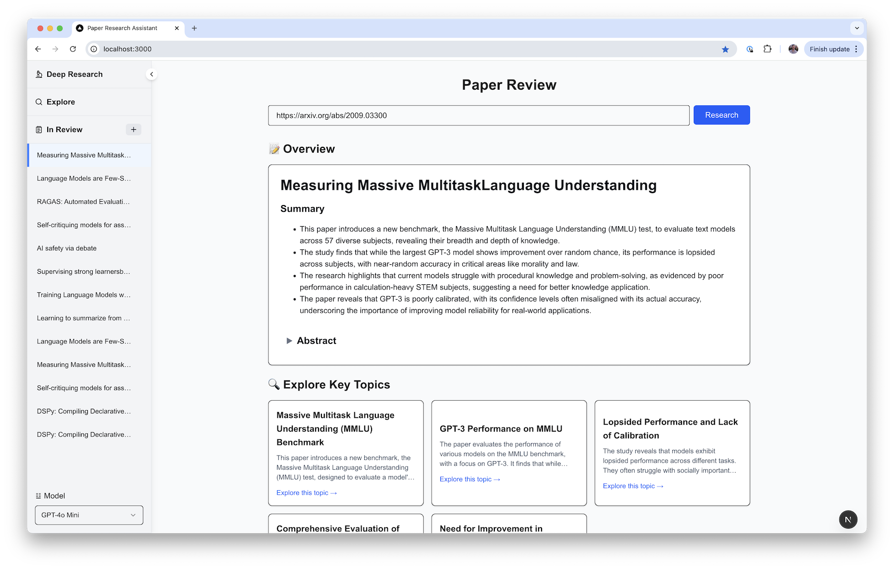

# Asistente de Investigación de Papers

## Descripción General

Un asistente de investigación basado en web que ayuda a los usuarios a explorar y analizar papers académicos. La aplicación presenta una interfaz web moderna con un sistema de investigación basado en pestañas y soporta múltiples modelos de IA para el análisis de papers.

Hay algunas opciones:

- **Resumen de Paper Individual**: Resume un paper, extrae temas clave para análisis y permite preguntas abiertas sobre ese paper.
- **Explorar**: Realiza preguntas abiertas contra un corpus de papers indexados en nuestro almacén vectorial (ver [backend/apptasks/](backend/app/tasks))
- **Investigación Profunda**: Una búsqueda web estilo OpenAI/Google deep research de páginas relacionadas con un paper dado. Puede usar navegación basada en texto o un agente web como [browser-use](https://github.com/browser-use/browser-use).



### Utiliza:

- [smolagents](https://github.com/huggingface/smolagents) para los agentes
- [QDrant](https://qdrant.tech/) como Base de Datos Vectorial
- [LiteLLM](https://www.litellm.ai/) para interactuar con proveedores de IA
- [Railway](https://railway.com/) para despliegues
- [FastAPI](https://fastapi.tiangolo.com/) y [Next.JS](https://nextjs.org/)

### Características Principales

- Interfaz de investigación interactiva con múltiples pestañas
- Capacidades de exploración de papers e investigación profunda
- Soporte para múltiples modelos de IA
- Almacenamiento persistente de sesiones de investigación
- Análisis de papers en tiempo real

## Configuración de Desarrollo

### Prerrequisitos

- Python 3.13+
- Node.js 18+
- [uv](https://github.com/astral/uv) para gestión de dependencias de Python
- Varias claves API para servicios de IA

### Configuración del Backend

1. Clona el repositorio
2. Navega al directorio backend
3. Configura el entorno con uv:

```bash
curl -LsSf https://astral.sh/uv/install.sh | sh
uv venv
source .venv/bin/activate
```

4. Instala las dependencias:

```bash
uv pip install -e .
```

5. Copia `.env.example` a `.env` y configura las claves.

6. Inicia el servidor backend:

```bash
fastapi dev main.py
```

### Configuración del Frontend

1. Navega al directorio frontend
2. Instala las dependencias:

```bash
npm install
```

3. Inicia el servidor de desarrollo:

```bash
npm run dev
```

El frontend está construido con:

- Next.js 15.2.0
- React 19
- TailwindCSS
- TypeScript

## Comandos de Desarrollo

Backend:

- Instalar dependencias de desarrollo: `uv pip install -e ".[dev]"`
- Formatear código: `black .`
- Lint: `ruff check`
- Verificación de tipos: `mypy`
- Ejecutar pruebas: `pytest`

Frontend:

- Servidor de desarrollo: `npm run dev`
- Construir: `npm run build`
- Iniciar servidor de producción: `npm run start`
- Lint: `npm run lint`
- Formatear código: `npm run format`

## CI/CD

### GitHub Actions

El proyecto utiliza tres flujos de trabajo principales de GitHub Actions que se ejecutan en los PRs:

1. **Análisis Estático de Python**: Ejecuta `black` (formateo), `ruff` (lint) y `mypy` (verificación de tipos) contra todo el código Python.
2. **Linting del Frontend**: Ejecuta `eslint` contra todo el código en `frontend`.
3. **Pruebas de Python**: Ejecuta el conjunto de pruebas `pytest` en `backend/app/tests`.

## Despliegue

La aplicación se despliega automáticamente en [Railway](https://railway.com) cuando los cambios se fusionan con la rama principal.